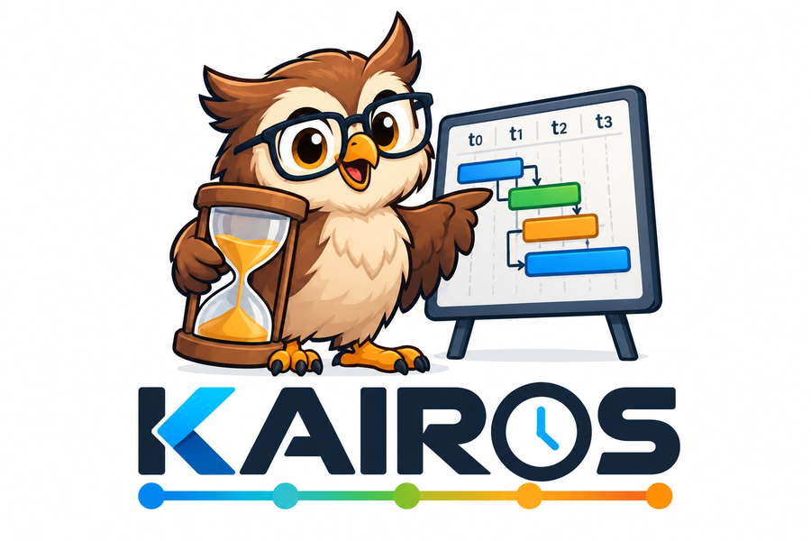

<p align="center">
  
</p>

<h1 align="center">Kairos</h1>

<p align="center">
  <b>A modern temporal and numeric PDDL planner in C++20, usable as a library and as an
  executable.</b>
</p>

<p align="center">
  <a href="https://github.com/PlanSys2/kairos/actions/workflows/ci.yml"></a>
  <a href="https://github.com/PlanSys2/kairos/actions/workflows/ci.yml"></a>
  <a href="LICENSE"></a>
  
  
  <a href="https://pixi.sh"></a>
  
  
</p>

Kairos aims to be a reference PDDL planner: broad language coverage, efficient on large problems,
robust, and easy to embed. It is developed within the [PlanSys2](https://github.com/PlanSys2)
organization and will become a planner for PlanSys2, but it does not depend on ROS.

> **Status: early development.** The core infrastructure is in place (build system, CI,
> diagnostics, cancellation and memory budget, logging), the PDDL front-end parses the whole of
> PDDL 3.1 and PDDL+ (13,149 of 13,152 public benchmark files; the other 3 are broken), and
> domains and problems can be checked (`kairos::check_domain`, `kairos::check_problem`), and plans
> can be read, written and validated (`kairos::validate_plan`, same verdicts as VAL on 515 test
> plans). Tasks are normalized into a lifted representation (disjunctions, existentials,
> derived predicates, durative actions, PDDL+) and grounded by relaxed reachability in Datalog,
> both checked against the validator; grounding gives the same atoms and actions as Fast
> Downward's translator (fewer where its static filters are tighter), several times faster.
> Ground tasks become SAS+ tasks with mutex groups found by invariant synthesis (also for
> durative actions), matching Fast Downward's, whose states are packed and expanded with a
> decision-tree successor generator (about 900,000 states per second), with blind, goal count,
> hmax, hadd and FF heuristics (numeric subgoaling, preferred operators) guiding lazy and
> eager greedy search, weighted A*, enforced hill-climbing and a LAMA-style anytime driver.
> **Kairos plans** problems without durative actions (STRIPS, ADL, derived predicates, numeric
> fluents, action costs), as a library and as the `kairos` executable, validating every plan
> before handing it over. The search combines the FF heuristic, LAMA-style landmarks and, on
> numeric tasks, novelty. Temporal planning comes next.

## Why another planner?

The planners that cover most of PDDL 2.1 (POPF, OPTIC, TFD, LPG) are no longer maintained, are
hard to build, and were not designed to be used as libraries: global state, no cancellation,
plans returned through stdout. The actively developed ones cover only part of the language
(numeric but not temporal, or temporal without temporal heuristics). Very few optimize metrics
that combine time and numeric fluents.

Kairos is written from scratch to close that gap.

## Goals

- **Coverage.** PDDL 2.1 level 3 (durative actions, required concurrency, numeric fluents),
  PDDL 2.2 (derived predicates, timed initial literals), full ADL also inside durative actions,
  and general metrics. Later: PDDL 3 constraints and preferences, object fluents and PDDL+.
- **Efficiency.** A fast engine for temporally simple problems (action compression plus
  rescheduling) and a complete one for required concurrency (snap actions with partial-order
  states and an incremental STN), chosen automatically by analyzing the task.
- **Anytime.** Get the first valid plan as soon as possible, keep searching in the background,
  and receive each better plan through a callback.
- **Modest hardware.** Plan on the robot's own computer (Raspberry Pi, Jetson): memory has a
  budget by default, and Kairos degrades gracefully instead of failing when it gets close.
- **Robustness.** Precise error messages with file, line and column; no crash on malformed input;
  cancellable; deterministic with a fixed seed.
- **Easy to use.** A small C++ API without global state, a command-line tool, PDDL validation
  without planning, and human-readable debug output per planner stage.
- **Measured.** A reproducible benchmark against the existing planners on IPC domains and on
  scaled-up PlanSys2 problems, with every plan checked by an independent validator.

## Usage

```cpp
#include <kairos/kairos.hpp>

// From files...
auto domain = kairos::load_domain("domain.pddl");
auto problem = kairos::load_problem("problem.pddl", *domain);
// ...or from strings already in memory
auto domain2 = kairos::parse_domain(domain_text);
auto problem2 = kairos::parse_problem(problem_text, *domain2);
// (on failure, ok() is false and diagnostics() say what and where)

kairos::Planner planner;

// In the calling thread: the best plan within the timeout
kairos::SolveOptions options;
options.timeout = std::chrono::seconds(10);
kairos::SolveResult result = planner.solve(*problem, options);
if (result.status == kairos::Status::Solved) {
  std::cout << kairos::to_string(*result.plan, kairos::PlanFormat::Ipc);
}

// Anytime, in its own thread: first plan as soon as possible, better ones through the callback
kairos::SearchOptions anytime;
anytime.timeout = std::chrono::seconds(60);
kairos::Search search = planner.start(*problem, anytime,
  [](const kairos::PlanUpdate & update) {
    // update.plan (validated, with its cost), update.index, update.elapsed
  });
auto first = search.wait_first(std::chrono::seconds(5));
kairos::SolveResult best = search.wait();  // or search.stop(); destroying it stops it too
```

`result.status` tells what happened (`Solved`, `Unsolvable`, `Timeout`, `Cancelled`,
`OutOfMemory`, `Unsupported`, `InvalidInput`, `GroundingTooLarge`), `result.stop_reason` why a
solved search ended (for instance `ProvenOptimal`), and `result.stats` where the time went.

The executable prints the plan to stdout (messages go to stderr):

```bash
$ kairos domain.pddl problem.pddl
; cost = 2
(move r1 kitchen corridor)
(move r1 corridor hall)
```

```bash
kairos domain.pddl problem.pddl --timeout 60 --output plan    # plan.1, plan.2... as they improve
kairos domain.pddl problem.pddl --format popf                  # for the PlanSys2 POPF plugin
kairos domain.pddl problem.pddl -v --debug=search,ground       # progress and statistics on stderr
kairos domain.pddl problem.pddl --search lama                  # a search preset (default: auto)
kairos check domain.pddl problem.pddl
kairos validate domain.pddl problem.pddl plan.txt
```

Exit codes: 0 solved, 10 unsolvable, 11 timeout, 12 out of memory, 13 unsupported, 2 invalid
input, 1 internal error. `kairos --help` lists every option.

## Checking PDDL

Already available: validate a domain, a problem on its own, or a problem against its domain,
without planning. Errors say where, in which action, and suggest fixes:

```cpp
#include <kairos/kairos.hpp>

kairos::CheckReport report = kairos::check_problem(problem_text, domain_text, "problem.pddl");
for (const auto & d : report.diagnostics) {
  std::cerr << kairos::to_string(d, problem_text) << "\n";
}
```

```
problem.pddl:3:20: error: in the initial state: argument 1 of 'robot_at' must be robot, 'kitchen' is room [semantic.type_mismatch]
 3 |   (:init (robot_at kitchen r1))
   |                    ^
problem.pddl:3:10: note: arguments 1 and 2 of 'robot_at' seem to be swapped [semantic.swapped_arguments]
```

## Building

Plain CMake, no ROS required:

```bash
cmake -S . -B build -DCMAKE_BUILD_TYPE=Release
cmake --build build
ctest --test-dir build --output-on-failure
```

Inside a colcon workspace:

```bash
colcon build --packages-select kairos
colcon test --packages-select kairos
```

As a conda package, with [pixi](https://pixi.sh) and the `pixi-build-cmake` backend (see
[pixi.toml](pixi.toml)); the package has the library, its headers, the CMake package and the
executable:

```bash
pixi publish --target-dir dist                      # dist/kairos-<version>-<build>.conda
pixi publish --to https://prefix.dev/<channel>      # or upload it to a channel
```

Requirements:
- CMake ≥ 3.24.
- GCC ≥ 13 or Clang ≥ 17.
- For the tests: GoogleTest (the system package, or fetched automatically), python3 and
  uncrustify.

### Options

| Option | Default | Effect |
|---|---|---|
| `KAIROS_BUILD_TESTS` | ON | gtest suites plus cpplint and uncrustify tests |
| `KAIROS_SHARED` | ON | Build `libkairos` as a shared library (OFF: static) |
| `KAIROS_SANITIZE` | empty | `address;undefined` or `thread` |
| `KAIROS_WARNINGS_AS_ERRORS` | OFF | `-Werror` (ON in CI) |
| `KAIROS_COVERAGE` | OFF | Coverage instrumentation |

### Using Kairos from another CMake project

```cmake
find_package(kairos REQUIRED)
target_link_libraries(my_target PRIVATE kairos::kairos)
```

## Testing

Every module comes with its GoogleTest suite. Tests cover edge values and sequences, not just the
happy path.

```bash
ctest --test-dir build                 # everything
ctest --test-dir build -L unit         # unit tests only
ctest --test-dir build -L lint         # cpplint and uncrustify
```

The external corpus tests parse and check about 13,000 public PDDL files (IPC 1998-2026, ENHSP
benchmarks). They are skipped unless the corpus is downloaded:

```bash
tools/fetch_corpus.sh                  # into ~/.cache/kairos/corpus, at pinned commits
KAIROS_PDDL_CORPUS=~/.cache/kairos/corpus ctest --test-dir build -R External
```

The lint tests apply the same rules as ROS 2 `ament_cpplint` and `ament_uncrustify`, using copies
of their tools in [tools/lint](tools/lint), so they work without ROS. To fix formatting:

```bash
uncrustify -c tools/lint/uncrustify.cfg --replace --no-backup <files>
```

Coverage of the library and the executable, with [gcovr](https://gcovr.com) 8 and the settings in
[gcovr.cfg](gcovr.cfg) (at least 90 % of the lines, or it fails):

```bash
cmake -S . -B build-cov -DCMAKE_BUILD_TYPE=Debug -DKAIROS_COVERAGE=ON
cmake --build build-cov && ctest --test-dir build-cov -LE lint
gcovr build-cov --html-details coverage/index.html
```

CI builds with GCC and Clang, runs the tests under AddressSanitizer, UndefinedBehaviorSanitizer
and ThreadSanitizer, on ARM64, and inside a 512 MB cgroup, and measures coverage (the report is
in each run's summary and as an artifact).

## Repository layout

```
include/kairos/   public API (the only installed headers)
src/core/         ids, symbols, diagnostics, budget, memory queries, logger
src/pddl/         PDDL front-end: lexer, parser, syntax tree, printer
src/semantic/     semantic analysis: types, declarations, features used
src/plan/         plans: reading plans of other planners, IPC/POPF/JSON output
src/validate/     plan validator, independent of the planner
src/api/          implementation of the public API
tests/            one directory per module, plus an install test (find_package)
tools/lint/       cpplint and uncrustify configuration
tools/fetch_corpus.sh  downloads the public PDDL benchmark collections used by corpus tests
cmake/            compiler options, lint tests, package config
fuzz/             fuzz targets and seed corpus (also replayed as tests)
docs/             documentation and images
```

Internal modules are static libraries linked into `libkairos`; only symbols marked `KAIROS_API`
are exported.

## Contributing

Contributions are welcome. See [CONTRIBUTING.md](CONTRIBUTING.md): Apache-2.0, signed-off commits
(DCO), one pull request per change with its tests, and the ROS 2 code style checked by the lint
tests.

## License

Apache-2.0. See [LICENSE](LICENSE).
